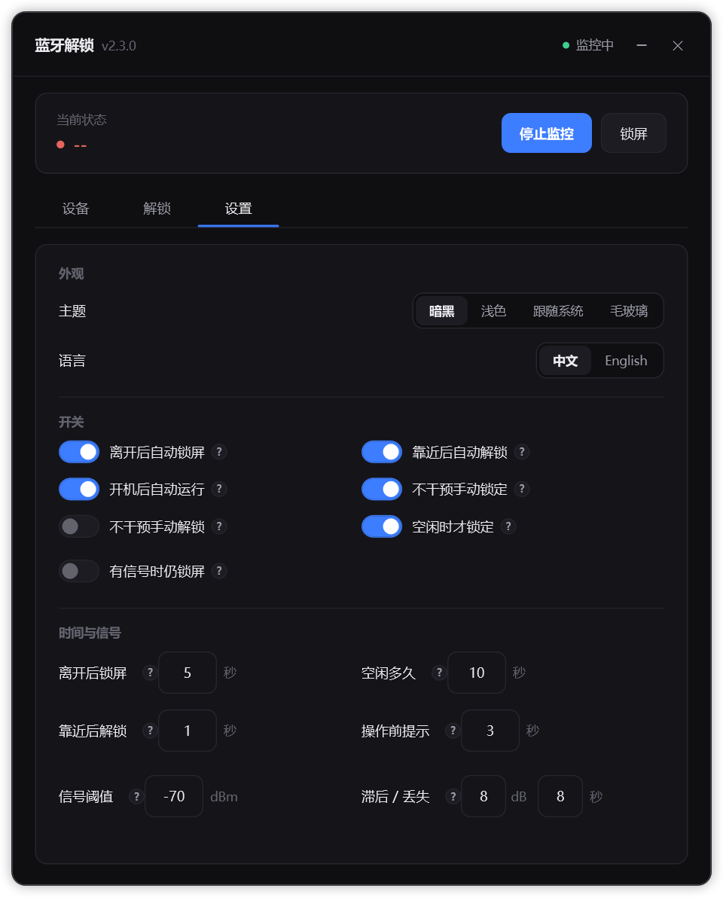
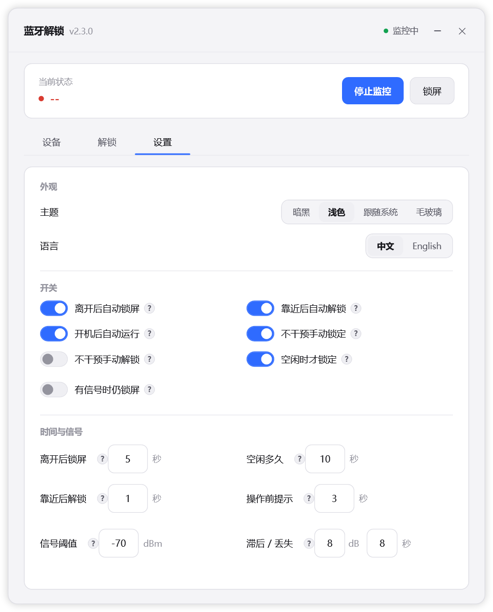
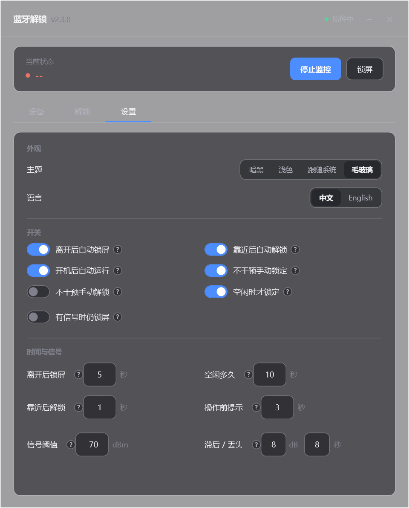

# Unlock Windows

用手机的蓝牙信号当钥匙：**靠近自动解锁 Windows，离开自动锁屏。**

不用装手机 App、不用联网、不上传任何数据 —— 只用本机蓝牙的信号强度判断远近。

**直接使用** → [下载免编译压缩包](https://github.com/xymei144/Unlock-Windows/releases/latest)　｜　**想改代码** → 见下方[编译](#编译)



## 特性

- **苹果设备友好** —— iPhone 的蓝牙地址会不断轮换、广播名还是乱码，程序按「地址 → 广播名」两级自动跟踪，地址变了不用管
- **三套主题** —— 深色 / 浅色 / 跟随系统 / Win11 毛玻璃，运行时即时切换
- **中英双语** —— 界面、托盘菜单、通知气泡全部本地化
- **多设备** —— 可绑多台设备，任一靠近即解锁，也可要求全部在附近
- **完全离线** —— 不联网、无遥测、无自动更新

<p>
  
  
</p>

## 运行要求

- Windows 10 / 11，64 位
- .NET Framework 4.8 —— Windows 11 和 2019 年 5 月之后的 Windows 10 **已自带**，无需安装；
  除此之外不需要装任何东西（无 VC++ 运行库依赖）
- 蓝牙 4.0 以上（能收到 BLE 广播）
- 手机需持续广播蓝牙信号（iPhone / 安卓均可；**Apple Watch 不行** —— 人在电脑前时它恰好不广播）

## 快速开始

从 [Releases](https://github.com/xymei144/Unlock-Windows/releases/latest) 下载压缩包，解压得到 `蓝牙距离锁` 文件夹（也可以自己编译，见下）：

1. 双击 `UnlockServer.exe`（会请求管理员权限）
2. 切到「解锁」页，填入你的 Windows 用户名和密码 → 点「启用本机解锁」→ **重启一次电脑**
3. 切到「设备」页 → 添加设备 → 筛选「低功耗」→ 选中自己的手机 → 确定
4. 切到「规则」页 → 打开「自动锁定」和「自动解锁」→ 保存

完整说明见 [docs/使用指南.md](docs/使用指南.md)。

> **怎么认出自己的手机？** 苹果手机的蓝牙名是一串乱码（如 `NGNG+g+...`），很难认。
> 把扫描窗口开着，然后**在手机上关掉蓝牙、等 10 秒再打开** —— 列表里消失又出现的那条就是你的手机。

## 编译

主程序是 .NET Framework 4.8 的 WPF 工程。

**有 Visual Studio**：打开 `UnlockServer.sln`，编译 `UnlockServer.Wpf`。

**没有 Visual Studio**（用系统自带 MSBuild + NuGet 包）：

```powershell
powershell -ExecutionPolicy Bypass -File scripts\build-wpf.ps1
```

脚本会自动还原 NuGet 包、下载新版 C# 编译器和 .NET 4.8 参考程序集。

> 「本机解锁」的凭据提供程序（`UnlockServer.Provider`）是 C++/CLI 工程，需要 Visual Studio
> 和 Windows SDK 才能编译；用不到的话可以跳过，只编译主程序即可（仅失去自动解锁，锁屏不受影响）。

## 目录结构

```
UnlockServer.sln
├── UnlockServer.Wpf/        主程序（WPF）
│   ├── Services/            主题、语言、配置、蓝牙服务
│   ├── ViewModels/          MVVM
│   ├── Views/               主窗口、扫描窗口、对话框、通知气泡
│   ├── Utils/               蓝牙扫描、RSSI 平滑、RPA 解析、本机解锁
│   └── Themes/              三套配色 + 两套语言字典（运行时热切换）
├── UnlockServer.Provider/   凭据提供程序（C++/CLI，注册到 Windows 登录界面）
├── UnlockServer/            旧版 WinForms 主程序（保留供参考）
├── scripts/build-wpf.ps1    无 VS 编译脚本
└── docs/                    使用指南、截图
```

## 已知问题

- 远程桌面会话连接期间，自动解锁可能失效
- 长时间运行后蓝牙扫描可能卡住，此时重启程序即可恢复
- 配置文件里的账号密码用的是源码内固定密钥的 AES 加密，**只能算混淆、不是安全保护**；
  介意的话建议只开启「离开自动锁屏」，不启用自动解锁
- 凭据提供程序为 x64，32 位系统不适用

## 许可

[MIT](LICENSE)
